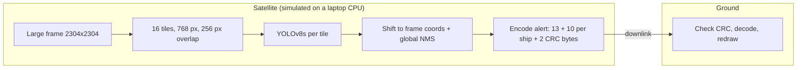
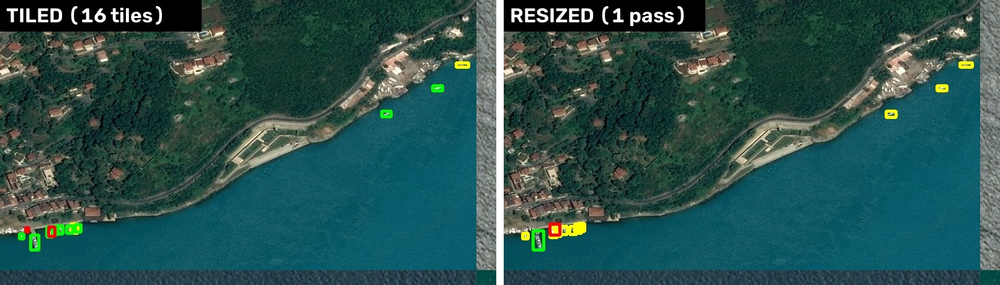
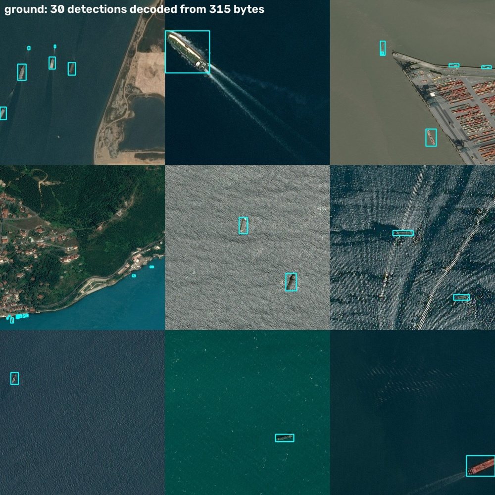

# Ship_satellite_edge_detector
Small demo for an on-device ship detector from satellite images.

A miniature, end-to-end version of an onboard maritime-surveillance pipeline: a large satellite frame is
cut into overlapping tiles, a YOLOv8s detector finds ships in each tile, duplicates are merged, and the
result is packed into a **315-byte binary alert** that a ground decoder verifies and redraws, instead of
downlinking a 1.5 MB image. Built in about one afternoon, on the
[Airbus Ship Detection](https://www.kaggle.com/competitions/airbus-ship-detection) dataset. All numbers
below are real measurements; limitations are listed explicitly.

## Pipeline



## Results

### 1. Detector (YOLOv8s fine-tuned at 768 px, 45 min on one A100, 92 epochs)

Subset: 8,000 images with ships + 800 empty, split 80/10/10 (stratified). The test set was never used for any decision.

| Split | Images | Ships | mAP50 | mAP50-95 | Precision | Recall |
|---|---|---|---|---|---|---|
| Val | 880 | 1,562 | 0.860 | 0.580 | 0.846 | 0.798 |
| **Test** | 880 | 1,585 | **0.857** | **0.570** | **0.850** | **0.790** |

Labels were decoded from run-length masks into boxes and checked visually before training
([`results/label_check.png`](results/label_check.png)); training curves in [`results/results.png`](results/results.png).

### 2. Tiled vs resized inference (10 synthetic frames, 169 ships, laptop CPU)

Each frame stitches 9 different test images into a 2304×2304 mosaic. The same model and threshold (0.25)
run either on 16 overlapping 768 px tiles, or once on the whole frame resized to 768 px. Predictions are
matched to ground truth at IoU ≥ 0.5.

| Method | Model runs | CPU time | Recall | Precision | Ships < 20 px | 20–50 px | > 50 px |
|---|---|---|---|---|---|---|---|
| **Tiled** | 160 | 69.7 s | **0.846** | 0.773 | **39/56 (70%)** | 34/42 (81%) | 70/71 (99%) |
| Resized | 10 | 4.5 s | 0.485 | 0.781 | 6/56 (11%) | 18/42 (43%) | 58/71 (82%) |

Resizing a 2304 px frame to 768 px shrinks every ship 3×: the median training ship (37 px) becomes ~12 px and
the smallest 5% (≤ 9 px) become ≤ 3 px. Tiling keeps training resolution and recovers almost all small vessels, at 16×
the model runs (~0.44 s per tile on this CPU).


*Harbour area of frame 0. Green = correct detection, red = false alarm, yellow = missed ship.*

### 3. Alert telemetry

One packet per frame: header (magic, version, frame id, timestamp, count) + 10 bytes per detection
(centre, size in pixels as uint16; confidence as uint8; class) + CRC-16-CCITT.

| Payload | Bytes | @ 9.6 kbps | @ 1.2 kbps |
|---|---|---|---|
| Raw RGB frame (2304×2304×3) | 15,925,248 | 3.7 h | 29.5 h |
| JPEG frame (quality 95) | 1,494,802 | 20.8 min | 2.8 h |
| **Alert packet (30 detections)** | **315** | **0.26 s** | **2.1 s** |

**Example packet** (frame 0, little-endian, from `python src/demo.py`):

```
header : 53 44 | 01 | 00 00 00 00 | db 2e 03 6b | 1e 00
         "SD"    v1   frame_id 0    Unix time      30 detections
ship 0 : 68 03 | f1 00 | ce 00 | c4 00 | ed  | 00
         cx 872  cy 241  w 206   h 196   0.93  class 0 (ship)
... 29 more ships x 10 bytes ... | CRC-16 (2 bytes)
```

Round trip: maximum box-corner error 0.69 px, maximum confidence error 0.0019. A packet with one flipped
byte is rejected by the CRC check. Times are lower bounds (no framing, FEC or link-availability overhead).



## How to run

```powershell
python -m venv .venv
.venv\Scripts\pip install -r requirements.txt
# models/best.pt is in the repo; put the val/test subset (zip produced by the notebook) in data/val_test_subset/
.venv\Scripts\python src\demo.py                   # whole flow, step by step: frame -> tiles -> detect -> merge -> alert -> ground
.venv\Scripts\python src\tiling.py --selftest      # tiling + NMS logic, no model needed
.venv\Scripts\python src\tiling.py --frames 10     # tiled vs resized
.venv\Scripts\python src\telemetry.py              # encode, decode, corruption test, size table
.venv\Scripts\python src\make_figures.py           # README figures
```

Training: [`notebooks/train_colab.ipynb`](notebooks/train_colab.ipynb) (Colab, A100; 45 min time-boxed training).

## Key design choices

Full reasoning, options and trade-offs for every choice: [`DECISIONS.md`](DECISIONS.md).

- **YOLOv8s at 768 px:** native image size, better small-object recall than v8n, realistic for a Jetson with TensorRT.
- **Ships + 10% empty images:** empty sea teaches the model what not to alert on.
- **80/10/10 split:** validation picks the checkpoint, so the README reports the untouched test set.
- **256 px tile overlap:** larger than 97.9% of ships in val+test, so they appear whole in at least one tile; costs no extra tiles on a 2304 px frame.
- **Hand-written NMS and matching in numpy:** short, explainable, portable to C++.
- **Alert v1 sends only fields we can fill honestly:** lat/lon, position uncertainty and heading are a documented v2; speed and predicted position belong to ground-side tracking across alerts.

## Limitations

- **Synthetic frames:** mosaics of unrelated 768 px crops with visible seams, not real large scenes.
- **CPU, not Jetson:** timings are from a laptop CPU and only show relative cost (16 runs vs 1).
- **Possible leakage:** Airbus images include overlapping crops of the same scenes; the random split may put near-duplicates in train and test, so scores may be optimistic.
- **Label noise:** some "false alarms" look like moored ships missing from the labels (e.g. at the quay in frame 0), so precision is likely a lower bound.
- **Axis-aligned boxes:** loose around diagonal ships (a 100×10 px ship at 45° fills ~16% of its box); side-by-side ships overlap and risk NMS suppression. In frame 0, two boxes on the same vessel next to the tile edge at x = 1792 (a 10×13 box inside a 22×66 one) survive plain IoU-NMS because their IoU is below 0.5.
- **Failure analysis is limited** to what the frames showed (harbour clusters, coastline, tiny boats); clouds and wakes were not examined systematically.
- **No georeferencing:** alerts carry pixel coordinates, not lat/lon.
- **Sensor mismatch:** Airbus imagery resolution and spectral response likely differ from a flight camera.
- **Single short run:** no hyperparameter search, one seed.
- The 10%-empty sampling ratio follows a cited competition recipe that was not independently verified.

## Next steps

- **Skip empty tiles:** a tiny classifier in front of the detector, to save Jetson compute and power, the scarcest resources in orbit.
- **TensorRT on the Jetson:** FP16/INT8 with calibration, re-checking small-ship recall after quantisation.
- **F´ integration:** wrap the payload as an F´ component; send alerts as F´ telemetry/events.
- **Oriented boxes (YOLO-OBB):** tighter boxes, better NMS for moored ships, and vessel heading for the alert.
- **Alert v2:** lat/lon (needs orbit position and attitude), position uncertainty, heading.
- **Ground-side tracking** across alerts for course, speed and predicted position.
- **Train at the flight camera's resolution** and spectral bands.
- **In-orbit model updates via compact weight deltas,** a continual-learning loop (detect unknowns, retrain, redeploy) like the one from my MSc work.

## Credits and licences

- Data: [Airbus Ship Detection Challenge](https://www.kaggle.com/competitions/airbus-ship-detection) (Airbus / Kaggle).
- Sampling recipe (ships + ~10% empty patches): [quangdungluong/hf-ship-detection](https://github.com/quangdungluong/hf-ship-detection).
- Related two-stage Airbus solution: [kheyer/Airbus-Ship-Detection](https://github.com/kheyer/Airbus-Ship-Detection).
- Detector: [Ultralytics YOLOv8](https://github.com/ultralytics/ultralytics), **AGPL-3.0**. Fine for a demo; flight or defence code would need a commercial licence or a differently-licensed detector.
